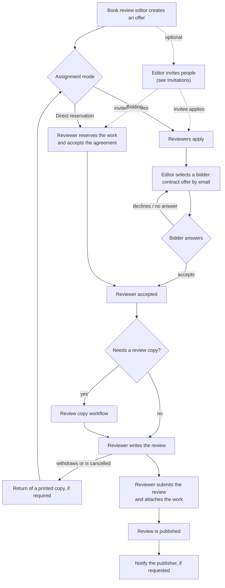
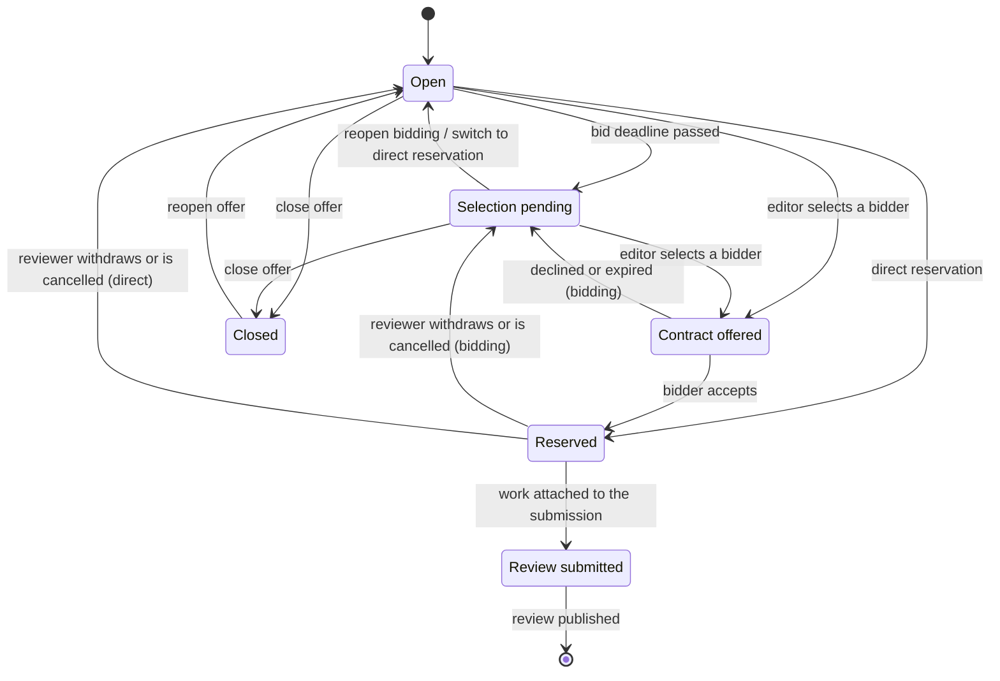
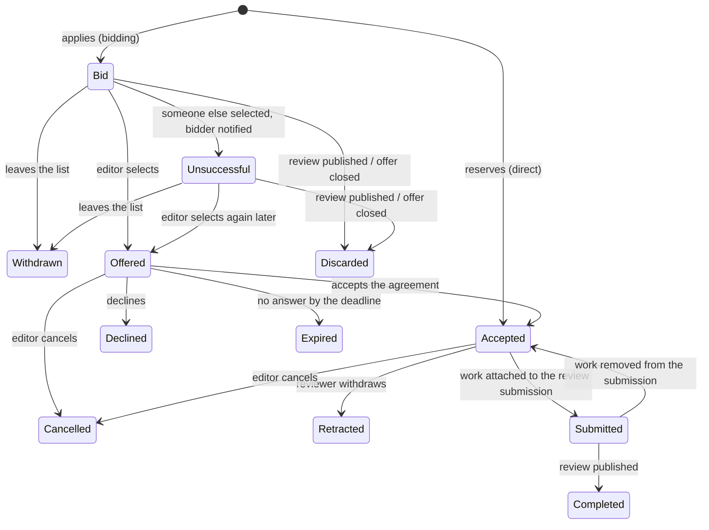
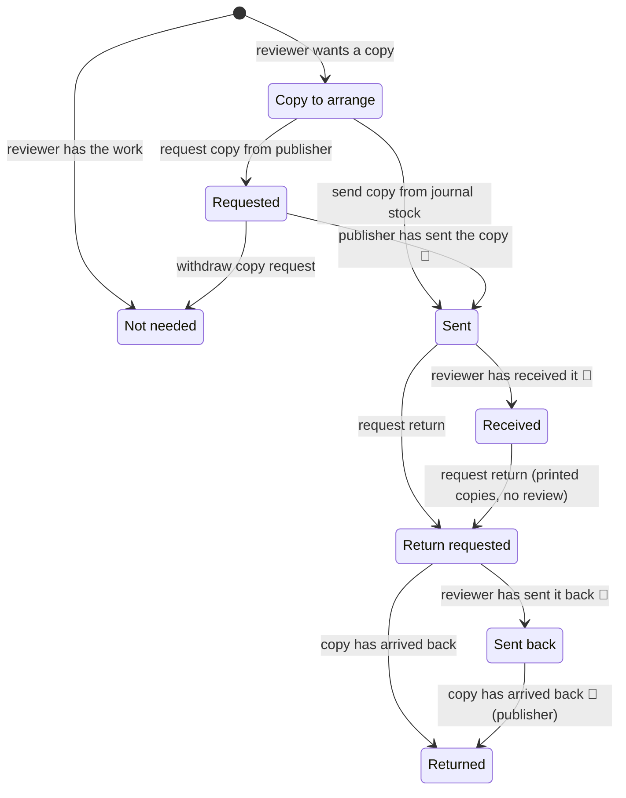
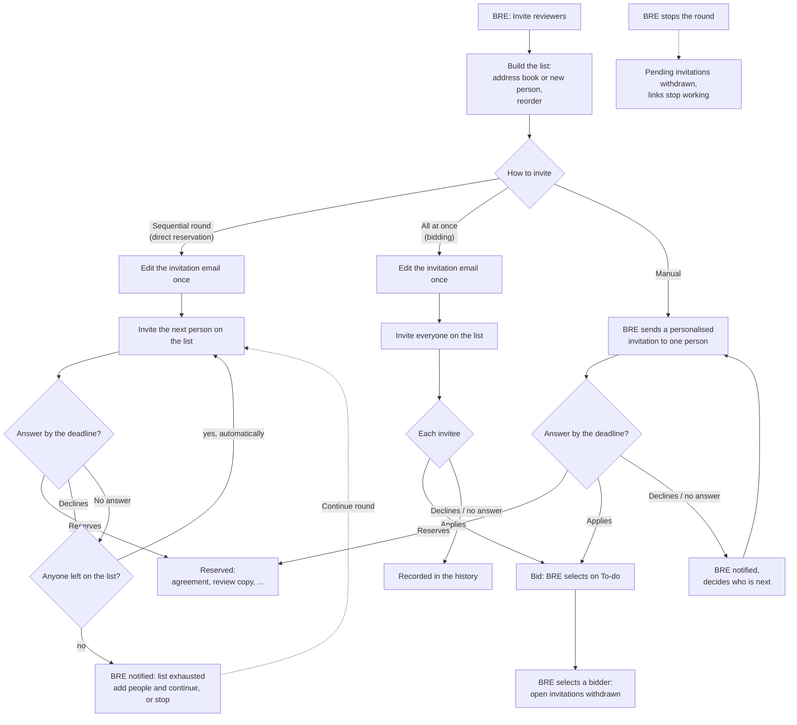
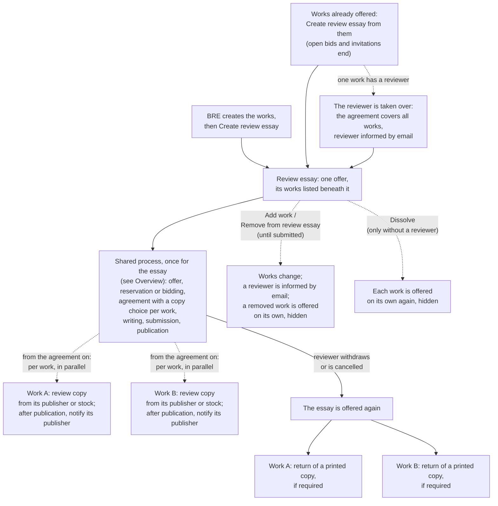

# The review workflow: a manual for book review editors

This manual describes how a work offered for review becomes a published review, and what you do as the book review editor along the way. To set up the plugin, see [Setting up the plugin](setup.md).

- [The workflow at a glance](#the-workflow-at-a-glance)
- [Flowcharts](#flowcharts)
- [Step by step](#step-by-step)
  1. [Offering a work](#1-offering-a-work)
  2. [Inviting reviewers](#2-inviting-reviewers)
  3. [Direct reservation](#3-direct-reservation)
  4. [Bidding: choosing a reviewer](#4-bidding-choosing-a-reviewer)
  5. [When a review does not materialise](#5-when-a-review-does-not-materialise)
  6. [The review copy](#6-the-review-copy)
  7. [While the review is being written](#7-while-the-review-is-being-written)
  8. [Submission and publication](#8-submission-and-publication)
  9. [Review essays: one review of several works](#9-review-essays-one-review-of-several-works)
- [Keeping track](#keeping-track)
- [Reference: statuses](#reference-statuses)

## The workflow at a glance

The people involved:

- **You, the book review editor**, offer works, choose reviewers, arrange review copies and keep things moving. Each offer has one *responsible* book review editor, who receives its notifications. Journal managers can do everything you can.
- **Reviewers** find works on the public page *For review*, or you invite them by email. They reserve a work directly or apply for it, accept the review agreement and later submit their review like any other article. They need an account in the journal.
- **Publisher contacts** send review copies and, if needed, receive returned ones. They never log in. Every step they take is a one-click link in an email.

You work from the backend menu section **Book Reviews**:

- **To-do** lists everything that needs a decision or is waiting for someone. This is your starting point.
- **Offered works** lists your offers. Here you create and edit them, hide them from the public page, and invite reviewers.
- **Reviewers & bidders** lists every bidder and reviewer, with their status, due date and delivery details.
- **Submitted reviews** lists works attached to review submissions.

Most steps that concern someone else come with a prefilled email that you can edit before it is sent. Everything is recorded in the offer's **history**.

## Flowcharts

### Overview

### Offer states

The state of an offer is shown on the To-do page and in the list of offered works.

### Bidders and reviewers

Each person who applies for or reserves a work has an *assignment* with one of these statuses:

### Review copy

Only reviewers who asked for a printed or electronic copy go through this workflow. Steps marked 🔗 can also be taken by the publisher contact or the reviewer with a one-click link in their email. Each such step sends the next person their email automatically.

### Invitations

How invitations work, from building the list to the answer. The mode depends on the offer: sequential rounds for direct reservation, "all at once" for bidding; manual invitations work for both.

### Review essays

A review essay is one review of several works (see [section 9](#9-review-essays-one-review-of-several-works)). The process with the reviewer runs once, for the essay. The review copy and the publisher notification run separately for each work. The chart shows an essay of two works, A and B.

## Step by step

### 1. Offering a work

Under **Offered works › Add work**, enter the work. With a DOI or ISBN, the lookup button fills in the authors, title, publisher and year. The optional **Description** (formatted text) appears below the title in the public list, e.g. to say what the work is about or what kind of review you are looking for.

Then decide how the offer works:

- **Assignment**:
  - *Direct reservation*: the first person to accept the terms on the public page gets the review.
  - *Bidding*: reviewers apply, and you choose. The default comes from the settings.
- **Bid deadline** (bidding only, optional): applications are accepted until the end of this day. When it has passed, the offer shows "Selection pending" until you choose.
- **Responsible book review editor**: receives the notifications about this offer.
- **Review copy**:
  - **Publisher contact**: the person at the publisher who provides the copy. Without one, you can't request copies from the publisher through the plugin.
  - **The journal holds a copy of this work**: you can send it from stock. Returned copies come back to the responsible editor, so that editor needs a mailing address in their profile.
  - **Printed copies must be returned if no review materialises**: on by default. If it is off, the return step isn't offered.
  - **The publisher wants to be notified when the review is published**: adds a reminder to To-do after publication.

The work now appears on the public page and in your list of offers.

**Hiding an offer.** To take a work off the public page without ending anything, use **Hide** in the row's actions (the arrow at the start of the row). The status column and To-do then mark the offer "Hidden", and the action changes to **Show**. While an offer is hidden:

- nobody can reserve it or apply for it on the public page;
- reviewers and bidders who already hold a reservation, an application or a contract offer still see it there, with their own actions;
- everything else keeps working: contract offers, review copies, reminders and email links.

Unlike **Close offer**, hiding keeps the list of bidders. Hiding and showing are recorded in the history.

### 2. Inviting reviewers

Instead of waiting for someone to reserve or apply on the public page, you can invite particular people. Click **Invite reviewers** in the row's actions under **Offered works**. This opens the work's invitation page.

You can send the invitations one by one, or let the plugin send them in a round: one after another for direct reservation, or all at once for bidding. The [flowchart](#invitations) shows how the modes work.

To invite people without others reserving the work first, hide the offer from the public list. Invitation links keep working for hidden offers.

#### Building the list

- **Add from the address book**: search the users of this journal by name, email or affiliation. Each person's entry shows how many reviews they have written for the journal and how many works they currently have reserved.
- **Add a new person**: enter their name, email and affiliation. This creates an account in the journal's Author group, so that they can submit the review later. No email is sent until you invite them. If someone already has an account with that email address, that account is used.
- **Order**: change the order with the arrows, or by dragging the rows. **Remove** takes people off the list as long as they haven't been invited.

#### Sending invitations one by one

**Send invitation** opens a prefilled email for that person, which you can edit. Which template it uses depends on the offer:

- for direct reservation, the invitation asks the person to review the work;
- for bidding, it asks them to apply.

The email contains a personal link and an answer deadline: by default 7 days, or the bid deadline for bidding offers with one. The link opens a page for this work, where the person can do one of two things without logging in:

- **accept:** agree to the review agreement and reserve the work (direct reservation), or apply with an optional statement (bidding);
- **decline:** say they can't review it, optionally with a reason.

Reserving or applying through an invitation works exactly like doing it on the public page. From then on, the normal workflow applies: the confirmation, the review copy, or your choice on To-do.

If an invitee declines or doesn't answer by the deadline, you are notified, and the list shows the status. You can then invite the next person, or send the same person a new invitation with **Invite again**. If a reminder is set up in the settings, invitees who haven't answered get one before the deadline. When someone reserves the work, other pending invitations are withdrawn. Invitations also stop working when bidding has closed or the offer is closed. Every step is recorded in the history.

#### Sequential rounds (direct reservation)

The plugin can also work through the list for you. Click **Start sequential round** and edit the invitation email once. The name, the deadline and the link are filled in for each person. The box **Hide from the public list during the invitation round** is ticked by default, so that nobody else can reserve the work while an invitee is still deciding. The work stays hidden after the round until you show it again.

The first person waiting on the list is invited at once. When they decline, or the deadline passes, the next person is invited automatically with the same text. A passed deadline is caught by the daily task, so the next invitation can go out up to a day later. A decline is only recorded in the history; you are not notified each time. The invitation page shows who is invited now, until when, and who is next.

The round ends when:

- **someone reserves the work**, through the invitation or on the public page;
- **you stop it** with **Stop round**: the pending invitation is withdrawn, and nobody further down the list is contacted;
- **the list runs out**: you receive an email. Add more people and click **Continue round**, or stop the round.

People can be added to the list while a round is running; they are invited after the others. People who declined or didn't answer are never invited again automatically, only with **Invite again** once the round is over.

#### All at once (bidding)

For a bidding offer, the button reads **Invite everyone on the list**. You edit the email once, and everyone waiting on the list is invited to apply at the same time. The deadline is the offer's bid deadline, or the default number of days if it has none. Here the box for hiding the offer is not ticked by default, since others may apply too.

- Applications appear on To-do under *Choose a reviewer*, as usual.
- Declines are recorded in the history, without an email to you.
- People added to the list later can be invited with **Invite the new people**.

The round ends when everyone has answered, when you select a bidder (which closes bidding and withdraws invitations that are still open), or when you stop it.

Changing an offer's assignment mode ends a round that no longer fits, and withdraws its pending invitations.

#### Invitations on To-do

The section **Invitations** on To-do lists every work with a round in progress or invitations waiting for an answer. It shows the mode, who is invited and until when, and in a sequential round who is next. Rounds that reached the end of the list are marked. From there you can go to the invitation page (**Invite more**) or stop a round.

### 3. Direct reservation

On the public page, works with direct reservation show **Offer to review**, and bidding works show **Apply**. Visitors who are not logged in are asked to log in. No one sees how many people have applied.

The reviewer accepts the terms of reservation, chooses a due date (within the maximum from the settings) and says how they will get the work:

- they already have it;
- a printed copy, with a shipping address and a phone number for the delivery service;
- an electronic copy;
- something else, explained in a text field.

The reservation takes effect immediately. You receive a notification, the reviewer receives a confirmation, and the work shows as reserved on the public page. If the reviewer asked for a copy, it appears on your To-do page under *Review copies* (see [The review copy](#6-the-review-copy)).

### 4. Bidding: choosing a reviewer

Reviewers apply with an optional statement about their interest and expertise. You receive an email for each new application.

On the **To-do** page, the section *Choose a reviewer* lists each bidding offer with its applicants:

- their statements;
- their affiliation;
- how many reviews they have already written for the journal.

Click **Select and send contract** next to the person you choose. A prefilled email opens: the contract offer, with a link to the review agreement and the deadline for answering (14 days by default). You can edit the text. The link is added when the email is sent.

Sending it closes bidding for the offer, and the offer shows "Contract offered". The selected bidder opens the link from the email; they don't need to log in. There they accept the agreement and choose the due date and the type of copy, just as in a direct reservation. Or they tell you they can't write the review, optionally with a reason.

If they don't answer, they are reminded automatically (after 7 days by default). If they still don't answer by the deadline, the offer expires and you are notified.

Once the agreement is accepted, To-do shows the section **Notify bidders who were not selected**. Click **Notify bidders**: the other applicants receive an email (which you can edit) saying that someone else was chosen. They stay on the list in case the review doesn't come about, and they can remove themselves with a link in the email.

Other actions for a bidding offer, below the list of bidders:

- **Switch to direct reservation**: the first person to accept the terms on the public page gets the review.
- **Reopen bidding**: accept new applications, for example when nobody on the list is suitable. Bidders already on the list stay on it.
- **Close offer**: remove the work from the public page. The list of bidders is discarded, and their statements are deleted. You can **reopen** a closed offer later.

### 5. When a review does not materialise

A review can fall through at several points:

- the selected bidder declines the contract offer, or doesn't answer in time;
- the reviewer withdraws, on the public page or with the "I cannot write this review" link in their confirmation and reminder emails;
- you cancel the reservation, from To-do or from *Reviewers & bidders*, for example because the review is long overdue.

You are notified in each case, and the offer becomes available again:

- **Bidding offers** return to *Choose a reviewer*, with a note on what happened. The waiting list is still there. When you select someone who was already told they weren't chosen, the email uses the separate template "offer available again". You can also reopen bidding or switch to direct reservation.
- **Direct reservation offers** reappear on the public page.

If the reviewer had received a **printed copy** and the offer requires returns, the copy row on To-do offers **Request return** (see below). Copies never go directly from one reviewer to the next. They go back to the journal or the publisher first, so that reviewers' addresses are never passed on.

### 6. The review copy

When a reviewer who wants a copy has accepted the agreement, the copy appears on To-do under **Review copies**. Each row shows the reviewer, the type of copy and its current state, where the copy comes from, and the steps that are possible now.

#### Getting the copy to the reviewer

1. **Request copy from publisher** (if the offer has a publisher contact). An email to the publisher contact opens, prefilled with the delivery details: the shipping address and phone number for a printed copy, the reviewer's email address for an electronic one. The reviewer's name is added automatically, so the address doesn't need to repeat it. The email contains a one-click link "I have sent the copy".

   

   Alternatively, use **Send copy from journal stock** if the journal holds a copy. The reviewer is told the copy is on its way, and the stock flag is cleared.
2. **The publisher has sent the copy.** The publisher confirms with the link from the email. Opening it shows a confirmation page, and only the button records the step.

   

   The reviewer then receives "Your review copy is on its way", with a link "I have received the copy". If the publisher tells you some other way, record the step yourself with **Publisher has sent the copy**; the email to the reviewer is optional.

   If the publisher doesn't react, they are reminded automatically, every 14 days by default. The row shows how many reminders have been sent. **Withdraw copy request** ends the request, for example if the publisher declines.
3. **The reviewer has received the copy.** The reviewer confirms with the link, on the public page, or you record it with **Mark as received**. The delivery address and phone number are deleted at this point.

There is no return or deletion step for electronic copies.

#### Getting a printed copy back

Only if the offer requires returns and the review won't come.

1. **Request return.** Choose where the copy goes:
   - *to the journal*: the responsible book review editor's mailing address (or the journal's);
   - *to the publisher*: the publisher contact's address.

   Which is right is your call. Usually it goes back to whoever sent it. The email to the reviewer contains the address and a link "I have sent the copy back". If the reviewer still holds an active reservation, requesting the return ends it.
2. **The reviewer has sent it back.** The reviewer confirms with the link, or you record it. If the copy goes to the publisher, the publisher contact is told it is on its way, with a link "The returned copy has arrived".
3. **The copy has arrived back.** The publisher confirms with the link, or you record it with **Copy has arrived back**. A copy returned to the journal is marked as held in stock, ready for the next reviewer.

### 7. While the review is being written

- **Confirmation.** After accepting the agreement, the reviewer receives a confirmation with the work, the due date and an "I cannot write this review" link.
- **Reminder.** Before the due date (14 days by default), the reviewer is reminded automatically. The reminder contains the same link.
- **Overdue reviews.** Reviews past their due date are listed on To-do under *Overdue reviews*. From there you can email the reviewer, change the due date, link the review submission if it was submitted without the reservation, cancel the reservation or request the return of a printed copy.
- **Changing the due date.** **Change due date** (on To-do under *Overdue reviews*, and on *Reviewers & bidders*) sets a new due date for a reserved review. The new date can be any day from today on; the maximum from the settings applies only to the reviewer's own choice. The reminder is sent again before the new date. Unless you untick the option, the reviewer is told by the email "Due date changed", which gives the old and new date and the link to the submission page. For a review essay, the works follow the new date. The change is recorded in the history.
- **Messages.** From *Reviewers & bidders* you can email any bidder or reviewer, or cancel a reservation, with an editable email.

### 8. Submission and publication

The reviewer submits the review as an ordinary submission. In the submission wizard, under *For the Editors › Reviewed works*, they pick the work they reserved. The offer then shows "Review submitted", and the reviewer's delivery details are deleted. In the editorial workflow, the review is handled like any other submission. If you are a section editor of the book review section, you can be assigned to it there.

**If the reviewer submitted without choosing the work.** Sometimes the review arrives without the link to the reservation. The reviewer might have used another account, typed in the book's details by hand, or someone else might have submitted it for them. In that case the offer still shows "Reserved" and the review is soon listed as overdue. Click **Link submission** on the reservation (on *Reviewers & bidders*, or on To-do under *Overdue reviews*). The form suggests the reviewer's submissions in the journal, those they submitted and those that list them as an author with the same email address. You can also enter the ID of any submission. Linking has the same effect as the reviewer choosing the work in the wizard: the offer shows "Review submitted", the delivery details are deleted, and the work appears under *Submitted reviews*. If the submission is already published, the review is marked as published right away. No email is sent, and the step is recorded in the history. For a review essay, link the essay; its works follow. To undo a wrong link, remove the work from the *Reviewed works* section on the submission's publication page.

When the review is **published**:

- the assignment is completed;
- the remaining bidders' entries are closed and their statements deleted;
- the reviewed work appears on the article page.

If the publisher asked to be notified, To-do shows the review under **Notify publishers of published reviews**. Click **Notify publisher** to send the publisher contact an email with a link to the review. You can edit the email first.

### 9. Review essays: one review of several works

A review essay is one review of several works, written by one reviewer. The essay is an offer of its own, and the works belong to it. The [flowchart](#review-essays) gives an overview.

What runs **once, for the essay**:

- the offer: the public page, the assignment mode, the bid deadline, the responsible book review editor, hiding;
- invitations, applications and the choice of a reviewer;
- the review agreement, the due date and the reminders;
- withdrawal and cancellation;
- submission and publication.

What stays **with each work**:

- its publisher contact and review copy settings;
- the review copy steps: request, sending, receipt, return, and the reminders to the publisher;
- the notification of the publisher after publication.

#### Creating a review essay

Click **Create review essay** above the list under **Offered works**. In the dialog, enter:

- **Title of the review essay** (required), for example "New books on legal pluralism", and an optional description. Both appear on the public page, as for a work.
- **Works**: tick the works the essay covers. Only works that can be combined are listed. Works that are already in a review essay, attached to a submission or closed are left out, and so are works with a pending contract offer or a running invitation round.
- **Hide the review essay from the public list for now**, if you want to invite people first.
- The assignment, the bid deadline and the responsible book review editor, as for a work.

To make an essay of works that are not offered yet, first enter each work with **Add work**, with its publisher contact and copy settings, and then create the essay from them.

In the list, the essay is shown with its works indented beneath it. On the public page, it is one entry with its title, description and works, which are not listed separately. Reservations, applications and invitations all concern the essay. The actions of the essay row are those of an ordinary offer (**Edit**, **Invite reviewers**, **Hide**, **History**, **Delete**), plus **Add work** and **Dissolve**. A work in an essay has only **Edit** (its bibliographic data and copy settings), **Remove from review essay**, **History** and **Delete**.

#### Combining works that are already offered

You can also create an essay from works that are already offered, with the same dialog. The rules:

- **At most one of the works may have a reviewer.** It is marked "has a reviewer" in the list of works. That reviewer becomes the reviewer of the essay: their agreement and due date now cover all the works. For each of the other works, choose the reviewer's access to it (has it, printed copy, electronic copy, other). The reviewer is informed with the email "Review essay changed". This email is sent with the template text, without editing. If two of the works have different reviewers, the essay can't be created, since an essay has one reviewer.
- **No pending contract offer or invitation round.** Such works aren't listed. Wait for the answer or stop the round first.
- **Open applications and invitations end.** When the works are combined, bids on them are closed ("List closed") and their statements are deleted, and pending invitations are withdrawn. Invite people again for the essay, or let them apply for it.

#### Adding and removing works

Until the review is submitted, you can change which works an essay covers:

- **Add work** in the essay's row, or **Add to review essay…** in the row of an ordinary work, adds a work. The same rules apply as for combining. A work that has a reviewer of its own can't be added to an existing essay; create a new essay from the works instead. If the essay has a reviewer, choose their access to the added work. The reviewer is informed with the email "Review essay changed", sent without editing.
- **Remove from review essay** in a work's row takes the work out. It is offered on its own again, but hidden; use **Show** when it should appear on the public page. If the essay has a reviewer, their agreement no longer covers the work, and they receive the email "Review essay changed", sent without editing. A printed copy they already received can be called back with **Request return** on To-do, as usual. The last work of an essay can't be removed; dissolve the essay instead.
- **Delete** on a work of an essay removes it from the essay first.

**Dissolving an essay.** **Dissolve** in the essay's row ends the essay: each work is offered on its own again, hidden at first. This is possible only while the essay has no reviewer and no pending contract offer. Bids and invitations for the essay are closed first. **Delete** on an essay does the same.

#### What the reviewer sees

- **Reserving, applying, invitations.** These work as for a single work, on the essay's entry or with the links in the emails. In the review agreement, the reviewer chooses one due date for the whole essay, and their access to each work separately ("Access to the works of the review essay (one choice per work)"). The shipping address and phone number are asked once, if any of the works is to come as a printed copy.
- **Confirmation, reminders, "I cannot write this review".** Once, for the essay.
- **Review copies.** Each work that needs a copy appears separately on To-do under *Review copies*, marked with the essay's title. Each copy comes from that work's publisher contact or from the journal's stock, and the copy emails name the work. The steps are those of [section 6](#6-the-review-copy).
- **Withdrawal or cancellation.** The essay as a whole becomes available again, as described in [section 5](#5-when-a-review-does-not-materialise). For each work, copies not yet arranged are no longer needed, and a printed copy that was sent can be called back with **Request return**, if that work requires returns.
- **Submission.** In the submission wizard, under *For the Editors › Reviewed works*, the reviewer picks the essay as one entry: its title, followed by the works. All works are attached to the submission together. The article page lists the works, not the essay.
- **Publication.** It completes the essay and all its works. Under **Notify publishers of published reviews**, To-do lists each work whose publisher asked to be notified.

*Reviewers & bidders* lists the reviewer once, for the essay. The essay has its own history, and the history of each work also records the essay's changes and the reviewer's progress.

## Keeping track

**History.** Every offer has a history, which you open with **History** on To-do or in the lists. It records who did what and when, and every email sent, with its full text. Steps taken through an email link are marked "via email link"; steps taken by the daily task are marked "automatically".

**Notes.** Replies and arrangements that don't go through the plugin aren't recorded by themselves: a reviewer's answer to your email, a phone call, an agreement with the publisher. Record them with **Add note** at the top of the history. Enter the text and the date it refers to, which is today by default, so you can also record something that happened earlier. The note appears in the history with your name. Notes are seen only by book review editors and journal managers, and they can't be changed or deleted, like the rest of the history.

**Reviewers & bidders** lists all assignments, with a filter by status. It shows the due dates, the chosen type of copy and the delivery details (as long as they are stored), with actions to email, change the due date, cancel or view the history.

**Submitted reviews** lists all works attached to review submissions, with the review submission and its status. Click a work to see its history.

## Reference: statuses

### Offer state

| State | Meaning |
| --- | --- |
| Open | On the public page, open for reservation or applications |
| Selection pending | Bidding has closed (deadline passed, or after a dropout); you need to choose |
| Contract offered | Waiting for the selected bidder to answer |
| Reserved | A reviewer has accepted the agreement |
| Review submitted | The work is attached to a review submission |
| Closed | You closed the offer; it is no longer public |

### Bidder or reviewer status

The labels are those shown in *Reviewers & bidders* (the flowchart above uses short names).

| Status | Meaning |
| --- | --- |
| Bid | Has applied |
| Not selected (on the list) | Someone else was chosen; still on the waiting list |
| Contract offered | Selected; waiting for an answer to the contract offer |
| Reserved | Has accepted the agreement and is writing the review |
| Review submitted | Has submitted the review |
| Review published | The review is published |
| Bid withdrawn | Left the list of bidders |
| Contract declined | Declined the contract offer |
| Contract offer expired | Did not answer the contract offer in time |
| Cancelled by the reviewer | Withdrew from the review |
| Cancelled by the editors | You cancelled the contract offer or reservation |
| List closed | Bid or invitation closed after publication or closure of the offer |
| On the invitation list | Added to the invitation list, not invited yet |
| Invited | Invitation sent; waiting for an answer |
| Invitation declined | Declined the invitation |
| Invitation not answered | Did not answer the invitation by the deadline |
| Invitation withdrawn | The invitation ended before an answer: someone else reserved the work, bidding closed, or you stopped the round |

### Review copy state

| State | Meaning |
| --- | --- |
| No copy needed | The reviewer has the work, or the request was withdrawn |
| Copy to arrange | Waiting for you to request or send the copy |
| Requested from the publisher | Waiting for the publisher |
| Sent | On its way to the reviewer |
| Received by the reviewer | Arrived; delivery details deleted |
| Return requested | The reviewer has been asked to return it |
| Sent back | On its way back |
| Returned | Back with the journal or the publisher |

**Works in a review essay.** The offer state and the reviewer's status belong to the essay; its works show the essay's state. Each work of the essay also has its own copy record for the reviewer, with one of the review copy states above. It follows the reviewer's status in the essay (reserved, submitted, published, or ended by withdrawal or cancellation), but it is not listed under *Reviewers & bidders* and gets no reminders of the due date. Its review copy state changes only through that work's copy steps.
